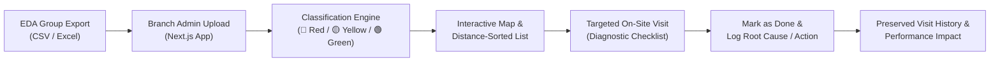
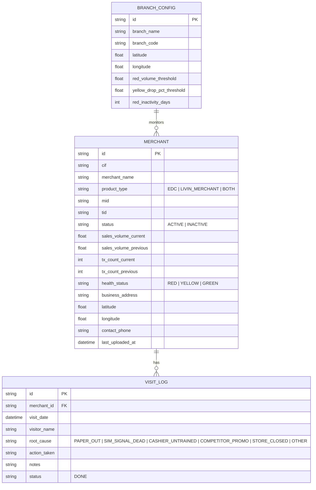

# Bank Mandiri Branch LVM & EDC Monitoring System (MVP)
## System Design Specification & Alignment Document

---

## 1. Executive Summary & Problem Scope

This system is an operational branch-level monitoring and field-intervention platform built for a **single Bank Mandiri branch**. It monitors all merchants successfully acquired and distributed by this branch across two key acquiring products:
1. **Mandiri EDC (Electronic Data Capture)** physical payment terminals.
2. **Livin' Merchant (LVM)** mobile merchant app and QRIS solutions.

The primary objective is to empower branch staff to proactively identify **underperforming merchants** (active terminals/accounts generating low sales volume or exhibiting sudden transaction drops, e.g., local coffee shops, cafes, retail stores) and conduct **targeted on-site visits** to diagnose root causes, provide solutions, and recover merchant turnover.



---

## 2. Core Decisions & Settled Architecture

| Dimension | Decision | Rationale |
| :--- | :--- | :--- |
| **Portfolio Scope** | Single Branch Only (All branch-acquired EDC & Livin' Merchant) | Eliminates corporate/wholesale jurisdictional conflict and multi-branch channel friction. Focuses purely on local branch execution. |
| **Data Ingestion** | Periodic CSV File Upload with Auto-Parsing | Sourced from Bank Mandiri's EDA (Enterprise Data Analytics) Group. Simplest and most reliable path for MVP without requiring core banking API integration. |
| **Data State Model** | Single Active State (Overwrite metrics) + Preserved Visits | Each new CSV upload updates the active merchant sales numbers while keeping historical visit records linked by CIF / MID intact. |
| **Classification Rules** | Dual-Condition with Configurable Thresholds | 🔴 **Red**: Active, but 0 tx in 14+ days OR volume < target (default < Rp 3M/mo)<br>🟡 **Yellow**: Active, but volume dropped >30% vs prior period<br>🟢 **Green**: Active with healthy volume above target |
| **Geospatial & UX** | Interactive Map + Distance-Ranked List + Pin Adjustment | Displays coordinates from the CSV on an interactive map (Leaflet/OpenStreetMap), sorted by distance from the branch, with 1-click Google Maps navigation and pin fine-tuning. |
| **Field Visit Workflow** | Lean Flow: Diagnostic Checklist + Mark as Done | Simple root cause logging (paper empty, signal dead, cashier untrained, competitor promo, store closed) and action notes. No camera or GPS geofencing enforcement for MVP. |
| **Tech Stack** | Full Cloud (Next.js, Vercel, Neon Postgres / Supabase) | Serverless deployment on Vercel with modern Next.js App Router, Tailwind CSS, and cloud PostgreSQL database. |
| **Demo & Seeding** | Sample CSV Template + "Load Sample Data" Button | Allows immediate out-of-the-box demonstration with realistic dummy merchants (e.g. coffee shops around Wisma Danantara, Gatot Subroto) before real CSV upload. |

---

## 3. Data Schema & CSV Contract

### 3.1 EDA CSV Input Contract
The uploaded CSV must contain the following fields:

```csv
cif,merchant_name,product_type,mid,tid,status,sales_volume_current,sales_volume_previous,tx_count_current,tx_count_previous,business_address,latitude,longitude,contact_phone
10982341,Kopi Kenangan Menara Mulia,EDC,MID8891001,TID445501,ACTIVE,1250000,8900000,18,124,"Menara Mulia GF, Jl. Jend. Gatot Subroto Kav. 9-11, Jakarta Selatan",-6.2258,106.8172,081234567890
10982342,Warung Kopi Sejahtera Tendean,LIVIN_MERCHANT,LVM99201,N/A,ACTIVE,450000,1200000,12,35,"Jl. Kapten Tendean No. 12, Mampang, Jakarta Selatan",-6.2345,106.8210,081298765432
```

### 3.2 Database Entity-Relationship Diagram



---

## 4. Business Logic: Health & Priority Classification

The system computes the `health_status` for every merchant dynamically upon CSV ingestion or threshold update:

```typescript
function calculateHealthStatus(merchant: Merchant, config: BranchConfig): 'RED' | 'YELLOW' | 'GREEN' {
  if (merchant.status !== 'ACTIVE') {
    return 'RED'; // Inactive terminal requires immediate salvage or recovery
  }

  // 1. Check Red Criteria: Zero transactions or below absolute floor
  const isZeroTx = merchant.tx_count_current === 0;
  const isBelowVolumeFloor = merchant.sales_volume_current < config.red_volume_threshold; // default: Rp 3,000,000

  if (isZeroTx || isBelowVolumeFloor) {
    return 'RED';
  }

  // 2. Check Yellow Criteria: Sudden drop vs previous period (> 30% drop)
  if (merchant.sales_volume_previous > 0) {
    const dropPercentage = (merchant.sales_volume_previous - merchant.sales_volume_current) / merchant.sales_volume_previous;
    if (dropPercentage >= config.yellow_drop_pct_threshold) { // default: 0.30
      return 'YELLOW';
    }
  }

  // 3. Otherwise Green (Healthy)
  return 'GREEN';
}
```

---

## 5. User Flows & Key Screens

### 5.1 Dashboard & Map Explorer
- **Interactive Map**: Centered on the branch coordinates. Red, Yellow, and Green custom marker pins. Clicking a pin opens a popup with Merchant Name, Product (EDC / Livin' Merchant), Sales Volume, % Drop, and buttons for *"Log Visit"* and *"Navigate in Google Maps"*.
- **Distance-Sorted Drawer / Table**: Sorts all merchants from closest to furthest based on Haversine distance formula from the branch. Filters by Status (All, Red, Yellow, Green) and Product (EDC, Livin' Merchant).
- **Summary Metrics**:
  - Total Active Merchants.
  - 🔴 Underperforming Count (Requires Visit).
  - 🟡 Watchlist Count.
  - 🟢 Healthy Count.
  - Completed Visits This Month.

### 5.2 Field Visit Modal
- Quick-tap modal triggered from map pin or table row:
  - **Date & Officer Name**: defaults to current date/time.
  - **Root Cause Multi-Check / Radio**:
    - [ ] Thermal Paper Roll Out (*Kertas Habis*)
    - [ ] SIM Card / Cellular Signal Dead (*Sinyal EDC Hilang*)
    - [ ] Cashier / Staff Untrained on Mandiri EDC or Livin' QRIS (*Kasir Belum Paham*)
    - [ ] Preferring Competitor Terminal (BCA, QRIS Shopee/GoPay) (*Pakai EDC Bank Lain*)
    - [ ] Store Temporarily / Permanently Closed (*Toko Tutup / Bangkrut*)
    - [ ] Other Issue (*Lainnya*)
  - **Action Taken & Notes**: Text area for follow-up actions (e.g. *"Supplied 5 rolls of thermal paper, test swipe Rp 1.000 successful, retrained morning cashier"*).
  - **Save & Mark as Done** button.

### 5.3 Admin & Settings Screen
- **CSV Uploader**: Drag-and-drop EDA CSV upload with column validation and summary preview before overwrite.
- **Download CSV Template**: Direct download of formatted sample CSV.
- **Load Sample Data**: One-click demo seeder with 20+ realistic merchants around Bank Mandiri KCP Wisma Danantara Indonesia (Gatot Subroto / SCBD / Semanggi).
- **Branch Configuration**:
  - Branch Name & Coordinates (Lat/Long).
  - Red Volume Threshold (Rp).
  - Yellow Volume Drop Percentage (%).

---

## 6. Implementation Roadmap

1. **Project Scaffold**: Next.js 15 (App Router), Tailwind CSS, Lucide Icons, Shadcn UI / Radix primitives.
2. **Database Integration**: Prisma or Drizzle ORM connecting to Neon Postgres / Supabase.
3. **Map Component**: Leaflet / React-Leaflet with OpenStreetMap tiles (SSR-safe dynamic import).
4. **Data Parser & Health Engine**: CSV parser with schema validation, distance calculation, and status determination.
5. **Visit Logging**: Form modal updating the `VisitLog` table with historical log view.
6. **Demo Seeding**: Built-in mock data for Bank Mandiri KCP Wisma Danantara Indonesia (Gatot Subroto / Semanggi cluster).
