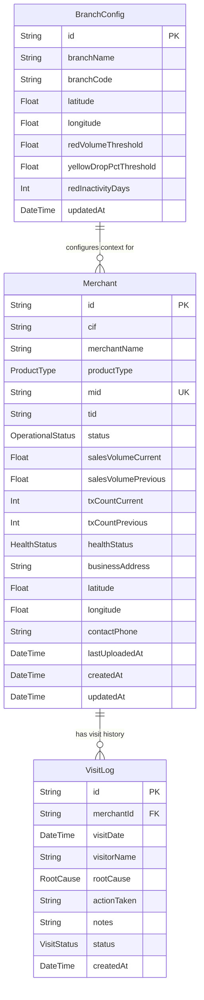
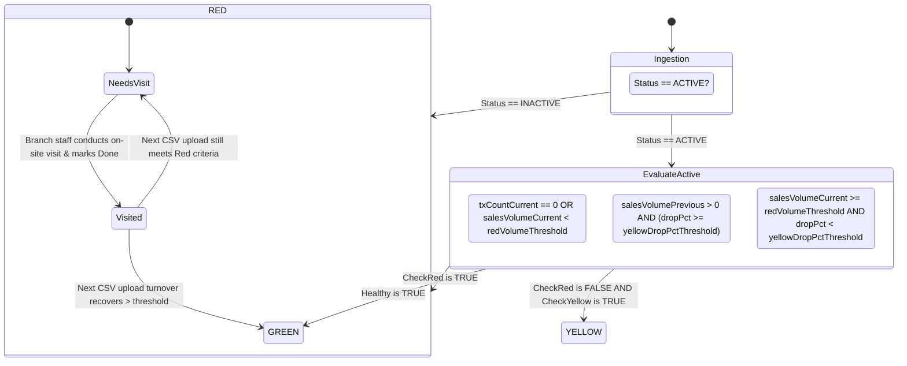

# Data Model Specification

**Feature**: Branch LVM & EDC Monitoring System  
**Feature Directory**: `specs/001-branch-lvm-edc-monitoring`  
**Date**: 2026-11-22  

---

## 1. Entity Definitions & Schema Overview

The system data model centers around three core entities:
1. **`BranchConfig`**: Stores branch anchor settings, physical branch coordinates, and health threshold parameters.
2. **`Merchant`**: Represents a commercial merchant account or physical terminal acquired by the branch, storing latest performance metrics and location data.
3. **`VisitLog`**: Represents an on-site intervention performed by branch personnel, preserving diagnostic findings and resolution actions.



---

## 2. Enums & Custom Types

```typescript
// Product Type acquired by the branch
export enum ProductType {
  EDC = "EDC",
  LIVIN_MERCHANT = "LIVIN_MERCHANT",
  BOTH = "BOTH"
}

// Operational status from core acquiring systems
export enum OperationalStatus {
  ACTIVE = "ACTIVE",
  INACTIVE = "INACTIVE"
}

// Computed health classification
export enum HealthStatus {
  RED = "RED",       // Underperforming (Needs visit)
  YELLOW = "YELLOW", // Watchlist / sudden drop
  GREEN = "GREEN"    // Healthy / stable
}

// Structured root cause identified during on-site visit
export enum RootCause {
  PAPER_OUT = "PAPER_OUT",                   // Kertas thermal habis
  SIM_SIGNAL_DEAD = "SIM_SIGNAL_DEAD",       // Sinyal cellular / SIM card mati
  CASHIER_UNTRAINED = "CASHIER_UNTRAINED",   // Kasir baru belum paham cara operasional
  COMPETITOR_PROMO = "COMPETITOR_PROMO",     // Kasir lebih prefer EDC/QRIS bank lain
  STORE_CLOSED = "STORE_CLOSED",             // Toko tutup sementara / bangkrut
  OTHER = "OTHER"                            // Masalah operasional lainnya
}

export enum VisitStatus {
  DONE = "DONE"
}
```

---

## 3. Prisma Schema (`schema.prisma`)

```prisma
datasource db {
  provider = "postgresql"
  url      = env("DATABASE_URL")
}

generator client {
  provider = "prisma-client-js"
}

model BranchConfig {
  id                      String   @id @default("default-branch")
  branchName              String   @default("Bank Mandiri KCP Jakarta Wisma Nusantara")
  branchCode              String   @default("10310")
  latitude                Float    @default(-6.193962)
  longitude               Float    @default(106.823673)
  redVolumeThreshold      Float    @default(3000000.0) // default Rp 3,000,000 / month
  yellowDropPctThreshold  Float    @default(0.30)      // default 30% drop vs previous period
  redInactivityDays       Int      @default(14)        // default 14 days zero transactions
  updatedAt               DateTime @updatedAt

  @@map("branch_configs")
}

model Merchant {
  id                    String            @id @default(cuid())
  cif                   String            // Customer Information File
  merchantName          String            // Business Trade Name
  productType           ProductType       @default(EDC)
  mid                   String            @unique // Merchant ID
  tid                   String?           // Terminal ID (optional if Livin' Merchant only)
  status                OperationalStatus @default(ACTIVE)
  salesVolumeCurrent    Float             @default(0.0)
  salesVolumePrevious   Float             @default(0.0)
  txCountCurrent        Int               @default(0)
  txCountPrevious       Int               @default(0)
  healthStatus          HealthStatus      @default(GREEN)
  businessAddress       String
  latitude              Float
  longitude             Float
  contactPhone          String?
  lastUploadedAt        DateTime          @default(now())
  createdAt             DateTime          @default(now())
  updatedAt             DateTime          @updatedAt

  visits                VisitLog[]

  @@index([healthStatus])
  @@index([latitude, longitude])
  @@index([cif])
  @@map("merchants")
}

model VisitLog {
  id           String      @id @default(cuid())
  merchantId   String
  merchant     Merchant    @relation(fields: [merchantId], references: [id], onDelete: Cascade)
  visitDate    DateTime    @default(now())
  visitorName  String
  rootCause    RootCause   @default(OTHER)
  actionTaken  String      @db.Text
  notes        String?     @db.Text
  status       VisitStatus @default(DONE)
  createdAt    DateTime    @default(now())

  @@index([merchantId])
  @@index([visitDate])
  @@map("visit_logs")
}
```

---

## 4. State Transitions & Health Derivation

The health status of each merchant is deterministically derived from performance numbers and branch threshold configurations:



---

## 5. Zod Validation Schemas

### 5.1 CSV Row Validation Schema
```typescript
import { z } from 'zod';

export const CsvRowSchema = z.object({
  cif: z.string().min(1, "CIF is required"),
  merchant_name: z.string().min(1, "Merchant name is required"),
  product_type: z.enum(["EDC", "LIVIN_MERCHANT", "BOTH"]),
  mid: z.string().min(1, "MID is required"),
  tid: z.string().optional().default(""),
  status: z.enum(["ACTIVE", "INACTIVE"]),
  sales_volume_current: z.coerce.number().min(0),
  sales_volume_previous: z.coerce.number().min(0).default(0),
  tx_count_current: z.coerce.number().int().min(0).default(0),
  tx_count_previous: z.coerce.number().int().min(0).default(0),
  business_address: z.string().min(1, "Address is required"),
  latitude: z.coerce.number().min(-90).max(90),
  longitude: z.coerce.number().min(-180).max(180),
  contact_phone: z.string().optional().default("")
});

export type CsvRowInput = z.infer<typeof CsvRowSchema>;
```

### 5.2 Visit Log Creation Schema
```typescript
export const CreateVisitLogSchema = z.object({
  merchantId: z.string().min(1, "Merchant ID is required"),
  visitorName: z.string().min(1, "Visitor name is required"),
  rootCause: z.enum([
    "PAPER_OUT",
    "SIM_SIGNAL_DEAD",
    "CASHIER_UNTRAINED",
    "COMPETITOR_PROMO",
    "STORE_CLOSED",
    "OTHER"
  ]),
  actionTaken: z.string().min(3, "Action taken summary is required"),
  notes: z.string().optional()
});
```
