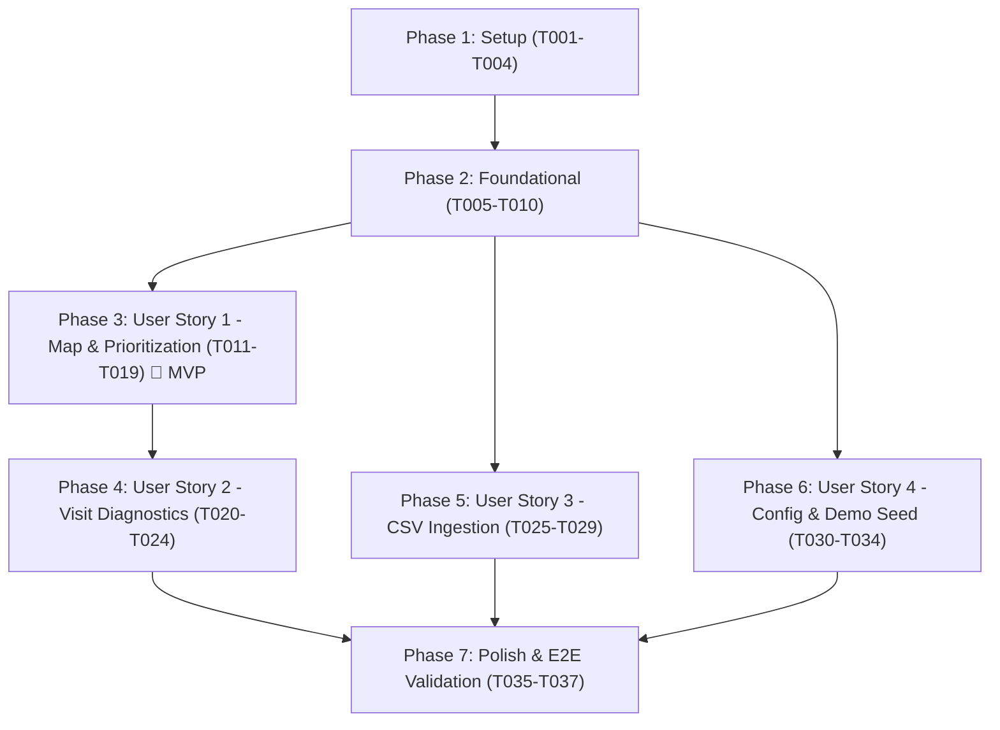

# Tasks: Branch LVM & EDC Monitoring System

**Input**: Design documents from `/specs/001-branch-lvm-edc-monitoring/`  
**Prerequisites**: [plan.md](plan.md), [spec.md](spec.md), [data-model.md](data-model.md), [research.md](research.md), [contracts/](contracts/), [quickstart.md](quickstart.md)  
**Organization**: Tasks are grouped into sequential Setup & Foundational phases, followed by User Story phases in priority order (P1 → P2 → P3), concluding with Polish.

---

## Format: `- [ ] [TaskID] [P?] [Story?] Description with file path`

- **[P]**: Parallelizable (independent files, no blocking dependencies)
- **[Story]**: User story label (`[US1]`, `[US2]`, `[US3]`, `[US4]`)
- Every task includes explicit target file paths and resolving citations to `data-model.md` for constrained fields.

---

## Phase 1: Setup (Shared Infrastructure)

**Purpose**: Initialize the Next.js 15 full-stack application and developer tooling.

- [x] T001 Initialize Next.js 15 App Router application with TypeScript and Tailwind CSS in `package.json`, `tsconfig.json`, and `tailwind.config.ts`
- [x] T002 [P] Install core runtime dependencies (Prisma, `@prisma/client`, `leaflet`, `react-leaflet`, `@types/leaflet`, `papaparse`, `@types/papaparse`, `zod`, `lucide-react`, `clsx`, `tailwind-merge`) in `package.json`
- [x] T003 [P] Configure environment variable template and database connection string in `.env.example` and `.env.local`
- [x] T004 [P] Configure Next.js server and client transpile settings for Leaflet assets in `next.config.ts`

---

## Phase 2: Foundational (Blocking Prerequisites)

**Purpose**: Core data layer, database schema, mathematical utilities, and global UI shell required before any user story can execute.

- [x] T005 Define Prisma schema with PostgreSQL models for `BranchConfig`, `Merchant`, and `VisitLog` citing `data-model.md` (`BranchConfig.id`, `BranchConfig.branchName`, `BranchConfig.branchCode`, `BranchConfig.latitude`, `BranchConfig.longitude`, `BranchConfig.redVolumeThreshold`, `BranchConfig.yellowDropPctThreshold`, `BranchConfig.redInactivityDays`, `Merchant.mid`, `Merchant.cif`, `Merchant.productType`, `Merchant.status`, `Merchant.healthStatus`, `VisitLog.rootCause`, `VisitLog.status`) in `prisma/schema.prisma`
- [x] T006 [P] Implement Prisma client singleton and database connection pooler in `src/lib/db.ts`
- [x] T007 [P] Implement Haversine great-circle distance calculation function in `src/lib/geo.ts`
- [x] T008 [P] Implement dynamic merchant health status calculation engine citing `data-model.md` (`Merchant.healthStatus`, `BranchConfig.redVolumeThreshold`, `BranchConfig.yellowDropPctThreshold`) in `src/lib/health.ts`
- [x] T009 [P] Create reusable UI primitives (Button, Card, Badge, Modal/Dialog, Input, Tabs) using Tailwind CSS in `src/components/ui/`
- [x] T010 Implement global application shell with header, navigation bar, and branch indicator in `src/app/layout.tsx`

**Checkpoint**: Foundation ready — database schema generated and core utility functions available. User story implementation can now begin.

---

## Phase 3: User Story 1 - Locate and Prioritize Underperforming Merchants (Priority: P1) 🎯 MVP

**Goal**: Display all branch-acquired merchants on an interactive map centered at the branch with color-coded status pins (Red, Yellow, Green), accompanied by a distance-sorted drawer, detail cards, external navigation, and pin adjustment.

**Independent Test**: Load a pre-seeded set of merchants and verify that underperforming (Red) merchants appear with distinct red pins and pulse markers, sorted from nearest to furthest in the drawer, with 1-click Google Maps navigation and pin coordinate saving.

- [x] T011 [P] [US1] Implement custom SVG map pin markers for Red, Yellow, and Green statuses with active pulse animations in `src/components/map/MapMarkers.tsx`
- [x] T012 [P] [US1] Create dynamic client-side Leaflet map container (`ssr: false`) with OpenStreetMap tiles in `src/components/map/LeafletMap.tsx`
- [x] T013 [US1] Implement `GET /api/merchants` endpoint returning distance-ranked merchants with status/product query filters per `contracts/api-endpoints.md` in `src/app/api/merchants/route.ts`
- [x] T014 [P] [US1] Build status badge component for `RED`, `YELLOW`, and `GREEN` citing `data-model.md` (`Merchant.healthStatus`) in `src/components/merchants/StatusBadge.tsx`
- [x] T015 [US1] Build merchant detail card displaying volume, drop %, contact phone, and Google Maps direction link citing `data-model.md` (`Merchant.merchantName`, `Merchant.salesVolumeCurrent`, `Merchant.salesVolumePrevious`, `Merchant.businessAddress`, `Merchant.contactPhone`) in `src/components/merchants/MerchantCard.tsx`
- [x] T016 [US1] Build distance-ranked merchant drawer with search, health status filter tabs, and product pills in `src/components/merchants/MerchantList.tsx`
- [x] T017 [US1] Implement `PATCH /api/merchants/[id]/coordinates` endpoint to update pin location citing `data-model.md` (`Merchant.latitude`, `Merchant.longitude`) per `contracts/api-endpoints.md` in `src/app/api/merchants/[id]/coordinates/route.ts`
- [x] T018 [US1] Build draggable pin adjustment tool allowing staff to fine-tune store location on the map in `src/components/map/PinAdjuster.tsx`
- [x] T019 [US1] Assemble main dashboard view integrating `LeafletMap`, `MerchantList`, summary statistic cards, and `MerchantCard` in `src/app/page.tsx`

**Checkpoint**: User Story 1 is functional and can be demonstrated as a standalone MVP!

---

## Phase 4: User Story 2 - Conduct On-Site Diagnostics and Record Field Visits (Priority: P1)

**Goal**: Enable branch staff to open a structured diagnostic visit modal on-site, select root causes (paper out, signal dead, cashier untrained, competitor promo, store closed), input action notes, and mark the visit as Done with persistent history.

**Independent Test**: Open an underperforming merchant, submit a visit report with root causes and resolution notes, and confirm the merchant shows "Visited Today" with the timestamped record appearing in the historical visit timeline.

- [x] T020 [P] [US2] Implement Zod validation schema for visit log submission citing `data-model.md` (`VisitLog.merchantId`, `VisitLog.visitorName`, `VisitLog.rootCause`, `VisitLog.actionTaken`, `VisitLog.notes`) in `src/lib/validations/visit.ts`
- [x] T021 [US2] Implement `POST /api/visits` endpoint to create a visit record and `GET /api/visits` to fetch merchant visit history per `contracts/api-endpoints.md` in `src/app/api/visits/route.ts`
- [x] T022 [P] [US2] Build diagnostic checklist modal with root cause radio options, action summary input, and "Mark as Done" action in `src/components/visits/VisitModal.tsx`
- [x] T023 [US2] Build chronological visit history timeline displaying past visiting officers, root cause findings, and resolution notes in `src/components/visits/VisitHistory.tsx`
- [x] T024 [US2] Integrate `VisitModal` trigger and `VisitHistory` tab into `MerchantCard.tsx` and connect mutation hooks to update dashboard counters in `src/components/merchants/MerchantCard.tsx`

**Checkpoint**: User Stories 1 and 2 work seamlessly together to complete the detection-to-resolution field loop!

---

## Phase 5: User Story 3 - Ingest Periodic Merchant Performance Data (Priority: P2)

**Goal**: Allow branch administrators to upload an updated EDA CSV dump, validate columns with Zod, batch upsert merchant metrics without wiping visit histories, and download standard CSV templates.

**Independent Test**: Upload a sample CSV file with updated volume numbers, verify invalid columns produce clear warnings, confirm merchant metrics and health statuses update immediately, and verify all previous visit logs remain attached.

- [x] T025 [P] [US3] Implement CSV parser and row-by-row Zod validator conforming strictly to `contracts/csv-contract.md` citing `data-model.md` (`Merchant.cif`, `Merchant.mid`, `Merchant.tid`, `Merchant.status`, `Merchant.salesVolumeCurrent`, `Merchant.salesVolumePrevious`, `Merchant.txCountCurrent`, `Merchant.txCountPrevious`, `Merchant.latitude`, `Merchant.longitude`) in `src/lib/csv.ts`
- [x] T026 [US3] Implement `POST /api/merchants/upload` endpoint with transactional batch upsert and automatic health status calculation in `src/app/api/merchants/upload/route.ts`
- [x] T027 [P] [US3] Create static downloadable EDA CSV sample file with realistic Bank Mandiri test rows in `public/templates/sample_eda_merchants.csv`
- [x] T028 [US3] Build drag-and-drop CSV upload widget with column validation preview, progress bar, and error breakdown table in `src/components/ingestion/CsvUploader.tsx`
- [x] T029 [US3] Assemble Data Ingestion management tab in `src/app/settings/page.tsx`

**Checkpoint**: Merchant data can now be refreshed repeatedly via periodic spreadsheet uploads!

---

## Phase 6: User Story 4 - Branch Health Thresholds & Demonstration Sandbox (Priority: P3)

**Goal**: Allow branch managers to configure branch name, anchor coordinates, and classification thresholds, and provide a 1-click "Load Sample Data" button to seed the database with realistic Central Jakarta (Thamrin/Menteng) merchants.

**Independent Test**: Modify the Red volume threshold in settings and verify that merchant health pins update immediately; click "Load Sample Data" and confirm 20+ realistic coffee shops and retail outlets populate the map.

- [ ] T030 [P] [US4] Implement `GET /api/branch-config` and `PUT /api/branch-config` endpoints citing `data-model.md` (`BranchConfig.branchName`, `BranchConfig.latitude`, `BranchConfig.longitude`, `BranchConfig.redVolumeThreshold`, `BranchConfig.yellowDropPctThreshold`) per `contracts/api-endpoints.md` in `src/app/api/branch-config/route.ts`
- [ ] T031 [P] [US4] Create realistic Central Jakarta Bank Mandiri merchant seed generator (coffee shops, bakeries, cafes around KCP Wisma Nusantara Thamrin) in `prisma/seed.ts`
- [x] T032 [US4] Implement `POST /api/seed` endpoint to trigger database reset and demo data population in `src/app/api/seed/route.ts`
- [x] T033 [US4] Build branch threshold configuration form and "Load Sample Data" demo controller in `src/components/settings/BranchSettingsForm.tsx`
- [x] T034 [US4] Add quick "Load Demo" action button in the global navigation bar in `src/components/navigation/HeaderActions.tsx`

**Checkpoint**: All four user stories are completely implemented and configurable.

---

## Phase 7: Polish & Cross-Cutting Concerns

**Purpose**: Responsive mobile styling, end-to-end quickstart validation, and documentation.

- [x] T035 [P] Audit and optimize mobile layout responsiveness for smartphone screens during on-site visits in `src/app/globals.css`
- [ ] T036 Execute all end-to-end validation scenarios documented in `specs/001-branch-lvm-edc-monitoring/quickstart.md`
- [x] T037 [P] Write comprehensive project documentation and deployment guide in `README.md`

---

## Dependencies & Execution Order

### Parallel Opportunities

- **Phase 1**: `T002`, `T003`, and `T004` can run in parallel after `T001`.
- **Phase 2**: `T006`, `T007`, `T008`, and `T009` can run in parallel once `T005` (Prisma schema) is defined.
- **Phase 3 (US1)**: `T011` (Map markers), `T012` (Leaflet container), and `T014` (Status badge) can run in parallel before assembling `T019`.
- **Phase 4 (US2)**: `T020` (Validation schema) and `T022` (Visit modal) can run in parallel.
- **Phase 5 (US3)**: `T025` (CSV parser) and `T027` (Sample template) can run in parallel.
- **Phase 6 (US4)**: `T030` (Config endpoint) and `T031` (Seed generator) can run in parallel.
